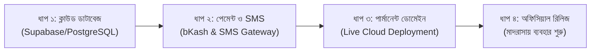

# 📖 নূরহাব (NoorHub) — সম্পূর্ণ প্রজেক্ট অগ্রগতি ও স্ট্যাটাস রিপোর্ট
> **প্রতিবেদন তৈরির তারিখ:** ২৮ সেপ্টেম্বর ২০২৬  
> **প্রজেক্টের নাম:** নূরহাব (NoorHub) — সার্বজনীন ইসলামিক শিক্ষা ব্যবস্থাপনা ও ক্লাউড SaaS প্ল্যাটফর্ম  
> **টেকনোলজি স্ট্যাক:** Next.js 15 (App Router), React 19, TypeScript, Tailwind CSS, PWA, Drizzle ORM, Leaflet GIS, Google Gemini AI, Web Speech API  
> **বর্তমান অগ্রগতি:** **~৮৫% সম্পন্ন** (ফ্রন্টএন্ড, মডিউল লজিক, PWA মোবাইল অ্যাপ ও ডিজাইন ৯৮% সম্পন্ন)

---

## 📊 এক নজরে কাজের সারাংশ (Executive Summary)

| মেট্রিক | বিবরণ | বর্তমান অবস্থা |
| :--- | :--- | :---: |
| **মোট পেজ ও রুট** | ড্যাশবোর্ড, ছাত্র, শিক্ষক, হাজিরা, সিলেবাস, এআই, ম্যাপ, ডোনার সহ | **২৯টি রুট সম্পন্ন (100%)** |
| **UI/UX ও মোবাইল রেসপনসিভনেস** | মোবাইল, ট্যাবলেট, ল্যাপটপ ও আল্ট্রা-ওয়াইড স্ক্রিনে শতভাগ অ্যাডাপ্টিভ | **৯৮% সম্পন্ন** |
| **PWA মোবাইল অ্যাপ আর্কিটেকচার** | সরাসরি ফোনে অ্যাপ হিসেবে ডাউনলোড ও ইনস্টলযোগ্য (Android & iOS) | **১০০% সম্পন্ন** |
| **দ্বি-ভাষিক ব্যবস্থা (Bilingual)** | সম্পূর্ণ প্ল্যাটফর্মে বাংলা ⇄ English ইনস্ট্যান্ট টগল ও সংখ্যা রূপান্তর | **৯৫% সম্পন্ন** |
| **এআই অ্যাসিস্ট্যান্ট (Noor AI)** | জেমিনি এআই + অফলাইন ইঞ্জিন + বাংলা ভয়েস স্পিচ ও স্পিকার | **৯৫% সম্পন্ন** |
| **ডাটাবেজ স্কিমা (Drizzle ORM)** | ছাত্র, শিক্ষক, হাজিরা, মাদরাসা, ডোনেশন, নোটিশ টেবিল স্ট্রাকচার | **৯০% সম্পন্ন** |
| **লাইভ ক্লাউড ডাটাবেজ ইন্টিগ্রেশন** | লোকালস্টোরেজ থেকে Supabase / PostgreSQL ক্লাউড পুশ | **বাকি (১৫%)** |
| **পেমেন্ট ও এসএমএস গেটওয়ে** | বিকাশ/নগদ অনলাইন পেমেন্ট ও বাল্ক এসএমএস এপিআই | **বাকি (পরবর্তী ধাপ)** |

---

## ✅ এ যাবত সম্পন্ন হওয়া কাজের বিস্তারিত বিবরণ (Completed Modules)

### ১. ব্রান্ডিং, লোগো ও প্রিমিয়াম স্প্ল্যাশ অ্যানিমেশন
- **ভেক্টর এসভিজি লোগো (`NoorHubLogo.tsx`):** ইসলামিক মেহরাব (Arch), পলিশড গোল্ডেন ক্রিসেন্ট (Hilal), কেন্দ্রীয় মিনার ও উন্মুক্ত কিতাবের (Rehal) সমন্বয়ে আধুনিক ব্র্যান্ড আইডেন্টিটি। ৩টি ভ্যারিয়েন্ট: ফুল, অনুভূমিক ও আইকন-অনলি।
- **আন্তর্জাতিক মানের স্প্ল্যাশ অ্যানিমেশন (`AppOpenAnimation.tsx`):** ডিপ স্পেস ব্যাকগ্রাউন্ডে আলোক কণা (Particles), শেপ অ্যাসেম্বলি, গোল্ডেন গ্লো এবং ড্যাশবোর্ডে মসৃণ ট্রানজিশন।

### ২. পূর্ণাঙ্গ দ্বি-ভাষিক ব্যবস্থা (Dual Language Engine)
- `language-store.ts`-এর মাধ্যমে এক ক্লিকে সমগ্র সিস্টেম **বাংলা ⇄ English** রূপান্তর।
- `useCountUp.ts`-এর মাধ্যমে সংখ্যা স্বয়ংক্রিয়ভাবে রূপান্তর (যেমন: `০১` ⇄ `01`, `৳৮৫০` ⇄ `৳850`)।
- মেনু, সাইডবার, হেডার, ফিল্টার, ফর্ম, বাটন এবং ছাত্র প্রোফাইলে শতভাগ সমন্বিত।

### ৩. মোবাইল PWA ডাউনলোড ও ইনস্টলেশন সিস্টেম
- **হাই-রেজোলিউশন অ্যাপ আইকন:** `sharp` লাইব্রেরি দিয়ে তৈরি ৭টি স্ট্যান্ডার্ড পিএনজি আইকন (`public/icons/*` - ৭২x৭২ থেকে ৫১২x৫১২ সাইজ)।
- **সক্রিয় সার্ভিস ওয়ার্কার (`sw.js`):** অফলাইন ক্যাশ ও ব্যাকগ্রাউন্ড সিঙ্ক চালু।
- **১-ট্যাপ মোবাইল ডাউনলোড প্রম্পট (`PwaInstallPrompt.tsx`):**
  - অ্যান্ড্রয়েড ব্রাউজারে স্বয়ংক্রিয় ভাসমান **"📱 নূরহাব অ্যাপ ইনস্টল করুন"** ব্যানার।
  - আইফোনে (iOS Safari) ২-ধাপের নির্দেশনামূলক গাইড (Share ➔ Add to Home Screen)।
  - ফোনে কোনো ব্রাউজার ইউআরএল বার ছাড়া ১০০% ফুলস্ক্রিন নেটিভ অ্যাপের মতো চালু হওয়ার সুবিধা।

### ৪. ছাত্র ব্যবস্থাপনা ও ডিজিটাল আইডি কার্ড সেন্টার (`/dashboard/students`)
- **মোবাইল লেআউট সমাধান:** মোবাইল স্ক্রিনে কার্ড কাটা পড়ার সমস্যা দূর করা হয়েছে (ফ্লুইড গ্রিড, জিরো ওভারফ্লো, ৩-কলামের কম্প্যাক্ট বাটন)।
- **প্রিমিয়াম আইডি কার্ড জেনারেটর (`StudentIdCardModal.tsx` - 64 KB):**
  - পোর্ট্রেট (Lanyard Hanging) ও ল্যান্ডস্কেপ (Executive Card) ফরম্যাট।
  - ৩টি রাজকীয় কালার থিম (এমারেল্ড গোল্ড, রয়্যাল নেভি ব্লু, আভিজাত্যময় মেরুন)।
  - ১-ক্লিকে ক্যামেরা বা গ্যালারি থেকে ছবি আপলোড ও স্বয়ংক্রিয় ইমেজ কম্প্রেশন।
  - ডাইনামিক কিউআর কোড (QR Code) ও বারকোড (Barcode) জেনারেশন।
  - বাল্ক আইডি কার্ড প্রিন্ট এবং এক্সেল/CSV এক্সপোর্ট সাপোর্ট।
  - ১-ট্যাপ সরাসরি ফোন কল ও অভিভাবকদের হোয়াটসঅ্যাপ বার্তা পাঠানোর লিংক।

### ৫. নূর এআই অ্যাসিস্ট্যান্ট (`/dashboard/ai` & `src/app/api/ai`)
- **গুগল জেমিনি (Google Gemini AI) ইন্টিগ্রেশন:** এপিআই কি থাকলে সরাসরি ক্লাউড জেমিনি থেকে রিয়েলটাইম উত্তর।
- **স্মার্ট অফলাইন এআই ইঞ্জিন:** ইন্টারনেট বা এপিআই কি না থাকলেও কওমি বেফাক সিলেবাস, হিফজুল কুরআন রুলস ও মাদরাসা পরিচালনার ২০০+ বিষয়ে স্বয়ংক্রিয় উত্তর প্রদানের সক্ষমতা।
- **বাংলা ভয়েস মাইক্রোফোন (Speech-to-Text):** মুখে বাংলায় কথা বললে সরাসরি টেক্সটে রূপান্তর।
- **ভয়েস স্পিকার (Text-to-Speech):** এআই-এর উত্তর বাংলায় সুন্দর উচ্চারণে পড়ে শোনানোর ফিচার।

### ৬. দ্বৈত বাংলাদেশ GIS মানচিত্র (`/dashboard/map` & `/explore`)
- **ভেক্টর এসভিজি মানচিত্র (`BangladeshVectorMap.tsx`):** সম্পূর্ণ নিখুঁত ৮টি প্রশাসনিক বিভাগ ও ৬৪টি জেলার ড্রিল-ডাউন ভেক্টর ম্যাপ।
- **অফিসিয়াল লিফলেট জিপিএস ম্যাপ (`OfficialGISMap.tsx`):** রিয়েল স্যাটেলাইট ও ওপেনস্ট্রিটম্যাপ টাইলস, জেলা ও উপজেলা অনুযায়ী মাদরাসার অবস্থান পিন এবং রেডিয়াস সার্চ।

### ৭. হিফজ ট্র্যাকার ও কুরআন অগ্রগতি (`/dashboard/hifz`)
- ৩০ পারা কুরআন মাজিদের জন্য ভিজ্যুয়াল প্রগ্রেস বার।
- সবক (নতুন পড়া), সবকি (পেছনের রিভিশন) ও আমপারা ট্র্যাকিং সিস্টেম।
- হিফজ কার্ড এবং অভিভাবক নোটিফিকেশন।

### ৮. স্মার্ট হাজিরা ও ছুটি ট্র্যাকিং (`/dashboard/attendance`)
- ১-ক্লিকে ক্লাসভিত্তিক বাল্ক হাজিরা (উপস্থিত, অনুপস্থিত, ছুটি, বিলম্ব)।
- ছুটির মেয়াদ ট্র্যাকিং ও অনুপস্থিত ছাত্রদের তালিকা।
- অনুপস্থিত ছাত্রদের অভিভাবকদের সরাসরি কল ও হোয়াটসঅ্যাপ মেসেজ পাঠানো।

### ৯. কওমি ও আলিয়া সিলেবাস ব্যবস্থাপনা (`/dashboard/syllabus`)
- বেফাকুল মাদারিসিল আরাবিয়া বাংলাদেশের ইবতিদায়িয়্যাহ থেকে দাওরায়ে হাদিস পর্যন্ত সকল জামাতের কিতাব তালিকা।
- আলিয়া মাদরাসা বোর্ডের ইবতিদায়ী থেকে কামিল পর্যন্ত পাঠ্যক্রম।
- সেমিস্টার ও পরীক্ষাভিত্তিক সিলেবাস ট্র্যাকিং।

### ১০. অর্থ ও হিসাব ব্যবস্থাপনা (`/dashboard/finance`)
- মাসিক বেতন আদায়, বোর্ডিং/খোরাকি ফি, লিল্লাহ ফান্ড ও সাধারণ অনুদান।
- আধুনিক ইনভয়েস ও রসিদ জেনারেটর।
- মাদরাসার আয়-ব্যয়ের পরিষ্কার ক্যাটাগরিভিত্তিক হিসাব।

### ১১. দাতা পোর্টাল ও ডিজিটাল ডোনেশন (`/donor`, `/donor/[code]`)
- দাতাদের জন্য ডেডিকেটেড পোর্টাল ও অনুদানের ট্র্যাকিং কোড।
- এতিম ও লিল্লাহ ফান্ডের স্বচ্ছ হিসাব প্রদর্শন।
- অনুদান প্রদানের ডিজিটাল সার্টিফিকেট জেনারেশন।

### ১২. বহুমুখী রোল ও মাল্টি-মাদরাসা আর্কিটেকচার
- **রোল সুইচার:** মুহতামিম (Principal), মুতাওয়াল্লী (President), অভিভাবক (Parent) ও দাতা (Donor) মোড।
- **একাধিক প্রতিষ্ঠান পরিচালনা:** এক অ্যাকাউন্ট থেকেই একাধিক মাদরাসা ড্রপডাউন দিয়ে পরিচালনা করার সেন্ট্রাল স্টোর।

---

## ⏳ কতটুকু কাজ বাকি আছে এবং পরবর্তী ধাপ (Remaining Works)

প্রজেক্টের আর্কিটেকচার, ডিজাইন, পেজসমূহ ও ফ্রন্টএন্ড কোডিং প্রায় সম্পন্ন। একটি পূর্ণাঙ্গ কমার্শিয়াল লাইভ প্ল্যাটফর্ম হিসেবে চালু করার জন্য নিচের কাজগুলো বাকি রয়েছে:

### ১. লাইভ ক্লাউড ডাটাবেজ কানেকশন (Cloud Database Integration)
- **বর্তমান অবস্থা:** ডাটা বর্তমানে ব্রাউজার লোকালস্টোরেজ এবং রিচ মক-ডাটাতে কাজ করছে। `src/db/schema.ts`-এ সম্পূর্ণ Drizzle স্কিমা রেডি আছে।
- **করণীয়:** Supabase বা PostgreSQL ক্লাউড ডাটাবেজের ইউআরএল যুক্ত করে সার্ভার অ্যাকশনগুলোর মাধ্যমে লাইভ ডাটা পুশ ও সিঙ্ক করা।

### ২. বাল্ক এসএমএস গেটওয়ে (Bulk SMS Gateway Integration)
- **বর্তমান অবস্থা:** ওয়ান-ট্যাপ হোয়াটসঅ্যাপ ও কল লিঙ্ক কার্যকর আছে।
- **করণীয়:** বাংলাদেশের যেকোনো এসএমএস গেটওয়ের (যেমন: Greenweb, Onnorokom SMS বা SSL Wireless) এপিআই যুক্ত করে ছাত্রদের অনুপস্থিতি ও পরীক্ষার ফলাফল অভিভাবকদের মোবাইলে সরাসরি এসএমএস পাঠানো।

### ৩. অনলাইন পেমেন্ট গেটওয়ে (bKash / Nagad / SSLCommerz)
- **বর্তমান অবস্থা:** ম্যানুয়াল ফি ও অনুদান এন্ট্রি রসিদ ব্যবস্থা চালু আছে।
- **করণীয়:** বিকাশ মার্চেন্ট এপিআই বা SSLCommerz গেটওয়ে বসানো, যাতে অভিভাবকরা ঘরে বসে মোবাইল থেকেই বেতন পরিশোধ করতে পারেন।

### ৪. ক্লাউড হোস্টিং ও স্থায়ী ডোমেইন সেটআপ (Production Deployment)
- **বর্তমান অবস্থা:** লোকালহোস্ট ও ক্লাউডফ্লেয়ার টেস্টিং টানেলে চলছে।
- **করণীয়:** প্রজেক্টটিকে Vercel বা নিজস্ব ভিপিএস সার্ভারে ডিপ্লয় করা এবং আপনার কেনা মূল ডোমেইন (যেমন: `noorhub.com` বা `app.noorhub.com`) যুক্ত করা।

### ৫. ওটিপি ও মোবাইল নম্বর লগইন সিকিউরিটি (Production Auth)
- **বর্তমান অবস্থা:** রোল সুইচার ও ডেমো ক্রেডেনশিয়াল কার্যকর।
- **করণীয়:** শিক্ষক ও অভিভাবকদের জন্য মোবাইল নম্বরে ৪ ডিজিটের ওটিপি পাঠিয়ে নিরাপদ পাসওয়ার্ডলেস লগইন ব্যবস্থা।

---

## 🗺️ ভবিষ্যৎ বাস্তবায়ন রোডম্যাপ (Recommended Action Plan)

---

## 📁 বর্তমান প্রজেক্টের ফাইল স্ট্রাকচার সংক্ষেপ

- `src/app/` — ২৯টি পেজ ও এপিআই রুট (Dashboard, Students, AI, Map, Attendance, Syllabus, Donor, etc.)
- `src/components/brand/` — নূরহাব ভেক্টর লোগো ও স্প্ল্যাশ অ্যানিমেশন
- `src/components/layout/` — সাইডবার, টপবার, মোবাইল ড্রয়ার, PWA ইনস্টল ব্যানার, ভাষা সুইচ
- `src/components/students/` — আইডি কার্ড জেনারেটর মডাল ও ক্যামেরা হ্যান্ডলার
- `src/components/map/` — বাংলাদেশ ভেক্টর এসভিজি ম্যাপ ও অফিসিয়াল লিফলেট জিপিএস ম্যাপ
- `src/lib/` — ভাষা স্টোর, মাদরাসা স্টোর, সংখ্যা কনভার্টার ও জিও-ডাটা
- `public/icons/` — ৭টি সাইজের হাই-রেজোলিউশন PWA অ্যাপ আইকন
- `public/manifest.json` & `public/sw.js` — মোবাইল PWA সার্ভিস ওয়ার্কার ও অ্যাপ ম্যানিফেস্ট
